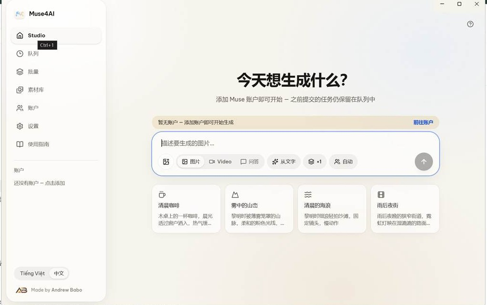
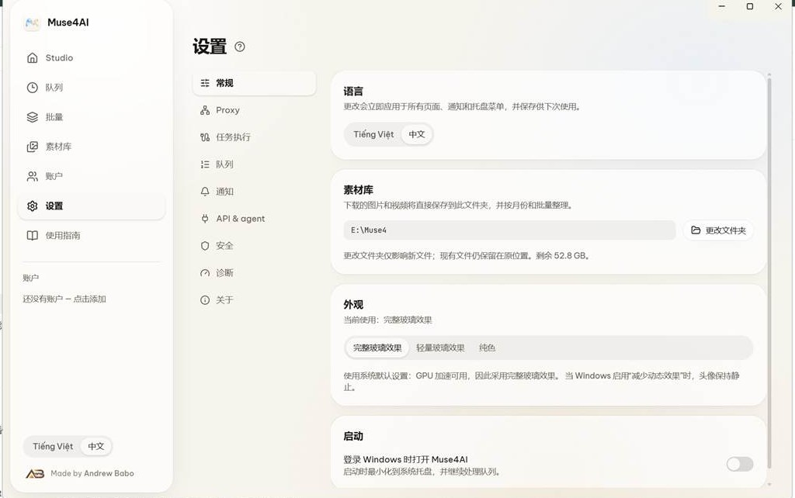

# Muse4AI · 简体中文汉化版

> **这是非官方的简体中文界面汉化版本。**
> 基于上游 [andrew-babo/muse4ai](https://github.com/andrew-babo/muse4ai) 的 `v2.0.0-beta.34`（commit `e007aac`）制作。
> 上游只提供英语和越南语界面；本版把 1835 条界面文案中的 1829 条译成简体中文（覆盖率 99.7%），
> 其余 6 条是纯占位符/符号，中英文形态一致。**只翻译界面文字，没有改动任何功能、接口、协议或业务逻辑。**
>
> 原作者 **Andrew Babo**，MIT 许可（`LICENSE` 原样保留）。本汉化版与原作者及 Meta Platforms, Inc. 无从属或背书关系。
> 英文原版说明见 [README.md](README.md)，汉化实现与还原方法见 [desktop/work/汉化说明.md](desktop/work/汉化说明.md)。





---

## 一、这是做什么的

Muse4AI 是一个跑在你自己 Windows 电脑上的桌面应用（Electron）。它把你**已经登录的 Muse 会话**
通过 **REST / MCP / OAuth** 交给 ChatGPT、Claude、Cursor、Codex、n8n 等 AI 智能体调用，
让智能体替你生成图片和视频——中间不经过任何云端中转，也没有按席位收费。

- 你在 Studio 里写提示词，或直接让智能体通过 API 提交任务；
- 任务进 Queue 排队执行，结果自动归档到 Library（素材库文件夹）；
- 应用数据保存在 `%APPDATA%\MuseStudio`，素材库文件夹可在设置里自选。

## 二、与上游版本的差异

| 项目 | 本汉化版 |
| --- | --- |
| 界面语言 | 简体中文（默认）+ Tiếng Việt（越南语）；**英文槽已被中文占用** |
| 界面文案 | 新增 `desktop/src/shared/i18n/catalog/zh.ts`，1829/1835 条中文化 |
| 语言标签 | 语言切换里的 `English` 显示为「中文」（语言 id 仍是 `en`） |
| 字体 | 字体栈补上 Microsoft YaHei / PingFang SC / Noto Sans CJK SC，避免中文回退成宋体 |
| 依赖安装 | `package-lock.json` 里 86 个私有 npm 代理地址已换成公共 `registry.npmjs.org`，`package.json` 补上 esbuild 安装脚本批准，**clone 后可直接安装** |
| 功能 / 接口 / 协议 / 数据结构 | **完全没动** |
| 许可 | MIT，保留原作者版权声明 |

## 三、快速开始

环境：Windows 10 / 11，Node.js 22+（本机实测 Node 24.19.0、npm 12.0.2），git。

```powershell
git clone <本仓库地址> muse4ai-zh
cd muse4ai-zh\desktop
npm install --no-audit --no-fund
npm run build
npm start
```

几个可能遇到的坑（上游仓库原始状态下会出现，本汉化版已替你处理前两条）：

1. **`EALLOWREMOTE`**：上游 `package-lock.json` 里 86 个包的 `resolved` 指向
   `https://europe-west1-npm.pkg.dev/lovable-core-prod/sandbox-npm-cache/`（私有 npm 代理），
   npm 11+ 会拒绝。本仓库已批量替换为 `https://registry.npmjs.org/`。
   若自己从上游 fork 后遇到，可执行
   `sed -i -E 's#https://europe-west1-npm.pkg.dev/lovable-core-prod/sandbox-npm-cache/#https://registry.npmjs.org/#g' package-lock.json`，
   再 `npm install --registry=https://registry.npmjs.org/`。
2. **esbuild 安装脚本**：npm 11 会拦截 postinstall；本仓库 `package.json` 已加 `allowScripts`。
   从上游 fork 时请执行 `npm install-scripts approve esbuild` + `npm rebuild esbuild`。
3. **克隆报 `CRYPT_E_REVOCATION_OFFLINE`**：证书吊销检查失败时，用
   `GIT_SSL_NO_VERIFY=1 git clone …`；这是网络环境问题，与本汉化无关。
4. **不随终端退出**：`npm start` 起的前台进程会随会话结束被关掉。需要长期运行时用独立进程：

   ```powershell
   powershell -NoProfile -Command "Start-Process -FilePath '.\node_modules\electron\dist\electron.exe' -ArgumentList '.' -WorkingDirectory (Get-Location).Path -WindowStyle Normal"
   ```

## 四、首次运行向导

第一次启动有 4 步：**Notice → Folder → Proxy → Account**。

- **Folder**：选素材库文件夹（图片/视频按月份和批量归档到此处），之后可在「设置 › 素材库」改；
- **Proxy**：没有代理就跳过；
- **Account**：可跳过，稍后到左侧「账户」里用自己的 Muse / Meta 账号登录。
  **登录必须由你自己完成**，应用不代管账号密码。

## 五、基本使用

左侧导航：

| 页面 | 用途 |
| --- | --- |
| Studio（创作台） | 写提示词，选 图片 / 视频 / 对话，或从文字生成、批量数量、Auto |
| 队列 | 看任务进度与结果 |
| 批量 | 批量任务 |
| 素材库 | 归档的图片和视频 |
| 账户 | 添加 / 登录账号（**生成任务的前提**） |
| 设置 | 语言、素材库、外观、开机自启、代理、队列、通知、API、安全、诊断、关于 |
| 使用指南 | 内置说明文档（**仍是英文**，见「已知边界」） |

推荐流程：**账户登录 → Studio 写提示词 → 队列看进度 → 素材库取结果**。

## 六、配置项

「设置」页主要分组：

- **通用**：语言（中文 / Tiếng Việt）、素材库文件夹、外观（完整玻璃 / 轻量玻璃 / 纯色）、登录 Windows 时开机自启；
- **Proxy**：HTTP 代理；
- **任务执行 / 队列**：并发数、重试等；
- **通知**：完成提醒；
- **API & agent**：见下；
- **安全 / 诊断 / 关于**：密钥、日志、版本信息。

### 让 AI 智能体接入（可选）

「API & agent」默认 **关闭**，关闭时不监听任何端口。打开后可 **Create key** 生成 `msk_…` 开头的密钥，
应用同时作为 OAuth 授权服务器。常用端点：

| 用途 | 地址 |
| --- | --- |
| 健康检查 | `http://127.0.0.1:47821/v1/health` |
| 提交任务 | `POST http://127.0.0.1:47821/v1/jobs` |
| MCP | `http://127.0.0.1:47821/mcp` |

示例（把 `YOUR_KEY` 换成自己的密钥）：

```bash
curl -X POST http://127.0.0.1:47821/v1/jobs \
  -H "Authorization: Bearer YOUR_KEY" \
  -H "Content-Type: application/json" \
  -d '{"kind":"video","prompt":"一只猫在雨天散步"}'
```

> 按项目 `CONTRIBUTING.md` 的要求：不要把真实密钥、OAuth token、cookie、代理密码、
> 邮箱或手机号贴进 issue、日志、截图或测试文件。

## 七、汉化原理

这个项目的所有 UI 文案在源码里以**越南语**写成，并直接作为查表键；
`src/shared/i18n/catalog/*.ts` 是「越南语 → 英文」映射。运行时按当前语言查表：
`vi` 直接显示越南语，`en` 查 `CATALOG` 显示英文译文。

汉化采用**覆盖英文槽位**的办法：新增 `zh.ts` 并追加到 `CATALOG` 合并链的最后一位，
于是 `en` 槽显示中文。语言 id 仍是 `en`，因此 `ipc.ts` 的 `z.enum(["vi","en"])`、
更新器、数字/日期格式化、已保存的 `settings.language = "en"` 都不用改，改动面最小、随时可还原。

改动文件共 4 个：`catalog/zh.ts`（新增）、`catalog/index.ts`、`i18n/index.ts`、`renderer/styles.css`。
其余 5 个英文 catalog **完全没动**。译文源数据、生成脚本与校验规则都在 `desktop/work/`：

```bash
cd desktop
node work/merge.mjs            # 由 work/out/batch-*.json 重新生成 zh.ts
npm run typecheck && npm run build
```

## 八、已知边界（不是 bug）

1. **未覆盖的 6 条仍是英文**。`merge.mjs` 严格校验：占位符集合必须与越南语键一致、
   不得含 `|`、不得含越南语带调字母、必须含至少一个汉字；不合规就跳过 → 回退英文。
2. **这 6 条全是纯占位符 / 纯符号**（如 `×{i}`、`{width}×{height}`），没有自然语言，中英形态相同。
3. **使用指南 / Agent Skill 文档**是独立静态内容（`content/`、`agent-kit/`），不在 `CATALOG` 内，仍是英文。
4. **数字、日期、默认头像名、更新说明**按 `locale === "en"` 走英文格式分支。
5. **折叠侧栏的语言小按钮**显示 `EN` 徽标（它是语言 id 大写，不是文案）；展开后是「中文 / Tiếng Việt」。
6. **少量短词保留英文**：Video、Auto、Proxy、token、Made by Andrew Babo 等技术词与品牌名。
7. **自带测试**：完整 `npx vitest run` 有 14 项失败，均为测试里写死了英文界面文案
   （`i18n.test.ts`、`i18n-api.test.ts`、`guide.test.ts`、`oauth.test.ts`），
   另 `main-modules.test.ts` 的 zip 用例因环境没有 `python3` 而失败。属预期结果，不是功能回归；
   `typecheck`、`build` 通过，`i18n-catalog.test.ts` 的占位符一致性校验 5 项全过。

## 九、切回英文 / 还原

语言切换只有「中文 / Tiếng Việt」两档，没有中文↔英文开关（英文槽已被中文占用）。
完全还原上游英文界面只需 3 步：

1. 删掉 `desktop/src/shared/i18n/catalog/index.ts` 里的 `import zh from "./zh";`；
2. 把同文件 `Object.assign(..., updates, zh)` 末尾的 `, zh` 删掉；
3. 把 `desktop/src/shared/i18n/index.ts` 的 `"中文"` 改回 `"English"`。

然后 `npm run build` 并重启应用。`zh.ts` 和 `work/` 留着或删掉都不影响运行。

## 十、验证结果（2026-11-09）

- `node work/merge.mjs` → accepted **1829**，回退英文 **6**，覆盖率 **99.7%**；
- `npx vitest run test/i18n-catalog.test.ts` → **5 passed**；
- `npm run typecheck && npm run build` → 通过；
- 重启应用后截图确认：创作台、示例卡片、左侧导航、设置页均已中文化，Microsoft YaHei 渲染正常无乱码。

## 十一、许可

[MIT](LICENSE) © 2026 Andrew Babo。第三方声明见 `desktop/LICENSES/`。
本汉化改动同样按 MIT 提供，保留原作者版权声明；Muse4AI 与 Meta Platforms, Inc. 无关联。
